# 12-апта: бірнеше текстура

**Тақырыбы:** екі текстураны бір объектіде біріктіру, текстура бірліктері
(texture units), араластыру коэффициентін uniform арқылы басқару.

Негізі 11-аптадағы текстураланған куб пен еркін камера. `loadTexture()`
11-аптадағыдай, жаңа функция жазылған жоқ.

## Құрастыру және іске қосу

```bash
cmake -S . -B build
cmake --build build
./build/bin/cg                 # қалыпты режим
./build/bin/cg --screenshots   # screenshots/ ішіндегі суреттерді қайта түсіреді
```

Іске қосқанда терминалға мына жазулар шығады:

```
.../assets/container.png  512x512  арна: 3
.../assets/pattern.png  512x512  арна: 3
.../assets/logo.png  512x512  арна: 4
tex1 = 1   tex2 = 2   tex3 = 3
```

## Басқару

| Перне | Әрекет |
|---|---|
| Тінтуір / дөңгелек | қарау / fov |
| W A S D, Space, Ctrl, Shift | жүру, жоғары, төмен, жүгіру |
| **↑ / ↓** | `blend` үлкейту / кішірейту (`0.5 * dt`, 0…1 аралығында) |
| **1** | `mix(a, b, blend)`: базалық, 3-тапсырма |
| **2 / 3 / 4** | `a * b` / `a + b` / `clamp(a + b, 0, 1)`: 3-тапсырма |
| **5** | логотип альфамен: `mix(base, decal, decal.a)` (4-тапсырма) |
| **6 / 7** | `mix(a, b, vTexCoord.y)` / `smoothstep` (5-тапсырма) |
| **8** | үш текстура (Қ1) |
| **U** | екі `glActiveTexture` жолы "комментарийде" (1-тапсырма) |
| **X** | `glUniform1i`-ге бірлік нөмірінің орнына текстура ID-і (2-тапсырма) |
| **B / F / O** | автоматты blend (Қ2) / әр жаққа бөлек blend (Қ3) / логотипті айналдыру (Қ4) |
| P | ағымдағы күйді консольге шығару |
| R | камера мен blend-ті бастапқы күйге қайтару |
| I / L / M | invert Y / pitch шектеуі / тінтуір режимі |
| F12 / ESC | скриншот / шығу |

Терезе тақырыбында тәсіл, `blend` мәні және қосулы тәжірибелер көрінеді.

## Базалық бөлім

```cpp
// 1. екі текстура
unsigned int tex1 = loadTexture(p1.c_str());   // container.png
unsigned int tex2 = loadTexture(p2.c_str());   // pattern.png

// 3. бірлік нөмірлері: циклден бұрын, glUseProgram-нан КЕЙІН
glUseProgram(shader);
glUniform1i(glGetUniformLocation(shader, "texture1"), 0);
glUniform1i(glGetUniformLocation(shader, "texture2"), 1);

// 4. әр кадр: glActiveTexture әрқашан glBindTexture-дан БҰРЫН
glActiveTexture(GL_TEXTURE0); glBindTexture(GL_TEXTURE_2D, tex1);
glActiveTexture(GL_TEXTURE1); glBindTexture(GL_TEXTURE_2D, tex2);
```

Фрагмент шейдері `mix(texture(texture1, uv), texture(texture2, uv), blend)`.
Вершина шейдері мен UV өзгерген жоқ, екі текстура бір UV жиынын қолданады.

| blend = 0 (тек жәшік) | blend = 0.5 | blend = 1 (тек өрнек) |
|---|---|---|
| 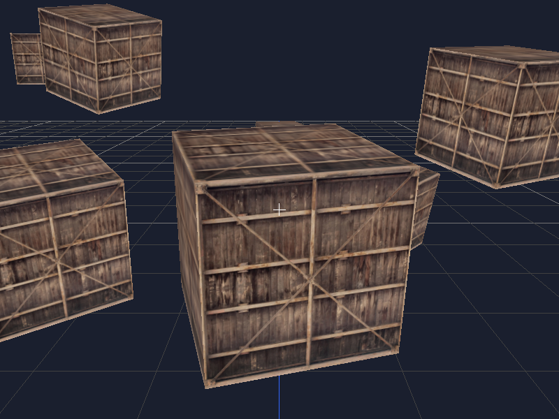 | 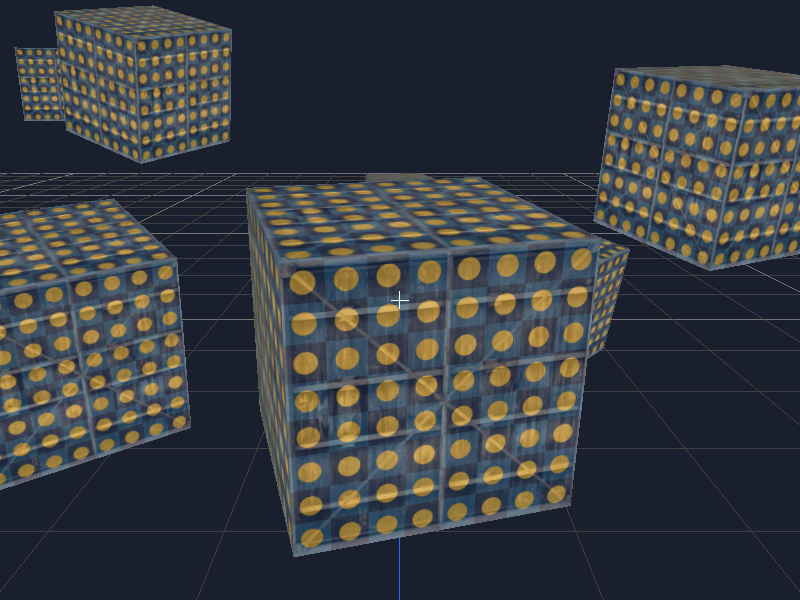 |  |

↑/↓ пернелерімен ауысу біртіндеп жүреді: `blend += 0.5f * dt`, яғни толық
ауысу 2 секунд алады.

## 1-тапсырма: бірліктерді әдейі шатастыру

Екі `glActiveTexture` жолы алынып тасталды (U пернесі):

```cpp
// glActiveTexture(GL_TEXTURE0);
glBindTexture(GL_TEXTURE_2D, tex1);
// glActiveTexture(GL_TEXTURE1);
glBindTexture(GL_TEXTURE_2D, tex2);
```

| blend = 0 | blend = 1 |
|---|---|
| 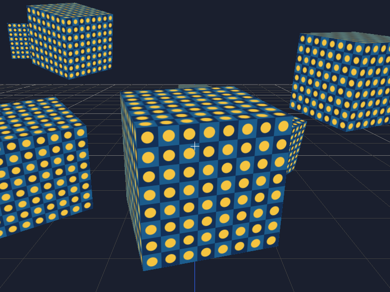 | 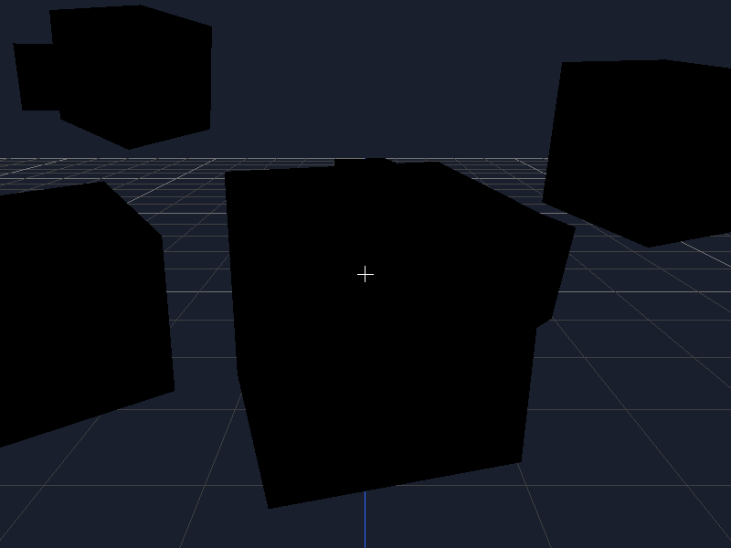 |

**blend = 0 болғанда** тек **өрнек** (pattern, tex2) көрінеді, жәшік мүлде
жоқ. **blend = 1 болғанда** кубтар **қап-қара**. Аралық мәндерде өрнек
біртіндеп қараяды.

**Екі бірлікте не тұр:**

```
glActiveTexture шақырылмаған → белсенді бірлік әрқашан 0 (әдепкі)

glBindTexture(tex1)  →  0-бірлік: tex1  (container)
glBindTexture(tex2)  →  0-бірлік: tex2  (pattern)  ← tex1 ығыстырылды
                        1-бірлік: бос   (текстура 0)

texture1 → 0-бірлік → pattern
texture2 → 1-бірлік → бос → (0, 0, 0, 1) = қара

mix(pattern, қара, blend):  blend = 0 → pattern,  blend = 1 → қара
```

`glBindTexture` "қай бірлікке" деп сұрамайды, ол тек **белсенді** бірлікке
жазады. Екі шақыру да 0-бірлікке түсті, екіншісі біріншісін ауыстырды.
1-бірлікке ештеңе байланбаған. Бос бірліктен оқу `(0, 0, 0, 1)` береді,
сондықтан екінші sampler қара оқиды.

> Бағдарлама жұмыс істеп тұрғанда U басылса, 1-бірлікте алдыңғы кадрлардан
> pattern қалып қояды да, мұндай қара көрінбейді. Сондықтан U қосылған сәтте
> бағдарлама 1, 2-бірліктерді тазалайды. Бұл `glActiveTexture`-сыз **іске
> қосылған** бағдарламаның күйі.

Тәжірибеден кейін U қайта басылса, жолдар "қайтарылады".

## 2-тапсырма: бірлік нөмірінің орнына ID

```cpp
std::cout << "tex1 = " << tex1 << "   tex2 = " << tex2 << std::endl;
glUniform1i(glGetUniformLocation(shader, "texture2"), tex2);   // әдейі қате (X)
```

**Терминалдағы ID-лер:** `tex1 = 1   tex2 = 2   tex3 = 3`.
`glGenTextures` ID-ді 1-ден бастап ретімен береді, ал 0 "текстура жоқ" деген
мағынаны білдіреді.

Енді `texture2` sampler-і 1-бірлікті емес, **2-бірлікті** оқиды. Ол жерде
ештеңе жоқ, сондықтан екінші текстура қара. `blend = 0.5` кезінде жәшік
жартылай қараңғы, өрнек мүлде жоқ:

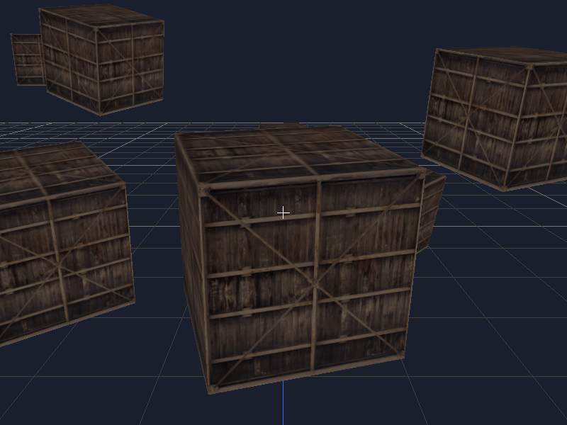

Ал 8-тәсілде (Қ1, үшінші текстура қосылғанда) 2-бірлікке `logo.png`
байланады. Сонда **сол қате код** қара емес, **басқа сурет** көрсетеді.
`blend = 1` кезінде өрнектің орнында логотиптің түстері шығады:

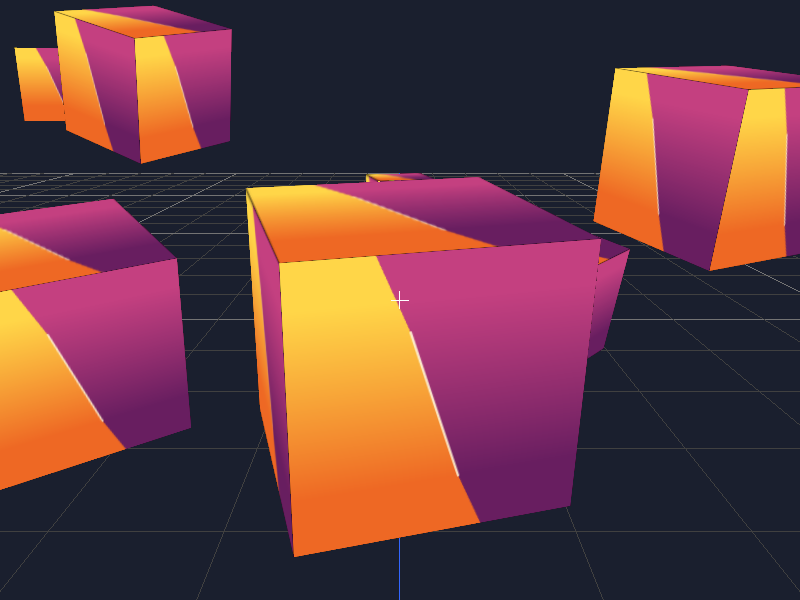

**Қорғауға:**

* `tex2`-нің ID-і **2**. Ол бірлік нөміріне (1) тең емес, сондықтан қате
  бірден көрінді.
* Егер `tex2` кездейсоқ **1** болса (мысалы, `tex1`-ге дейін жүктелсе), код
  **жұмыс істеп кетер еді**: ID мен бірлік нөмірі сәйкес келген. Қате кодта
  тұрады, бірақ экранда ештеңе байқалмайды.
* **Қауіптілігі:** қате жазылған сәтте пайда болмайды. Ол кейін, кодтың
  басқа жерін өзгерткенде шығады: үшінші текстураны қосқанда, жүктеу ретін
  ауыстырғанда, шрифт, shadow map немесе framebuffer текстурасы сияқты
  кез келген жаңа `glGenTextures` ID-лерді жылжытқанда. Сонда бұрын "жұмыс
  істеген" код кенеттен қара немесе бөтен суретті көрсетеді. Ал өзгертілген
  жер мүлде басқа файлда болуы мүмкін. Жоғарыдағы екі скриншот осыны
  көрсетеді: бір қате, бірақ 2-бірлікте не тұрғанына қарай нәтиже әртүрлі.
* Сондықтан бірлік нөмірі **әрқашан әріппен** жазылады: `0`, `1`, `2`.
  ID (`glGenTextures` нәтижесі) тек `glBindTexture`-ға беріледі.

## 3-тапсырма: төрт араластыру тәсілі

| 1. `mix(a, b, 0.5)` | 2. `a * b` |
|---|---|
|  | 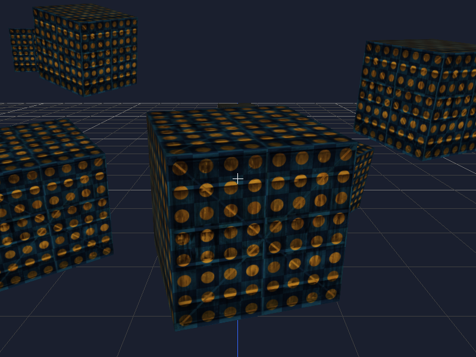 |
| **3. `a + b`** | **4. `clamp(a + b, 0, 1)`** |
|  | 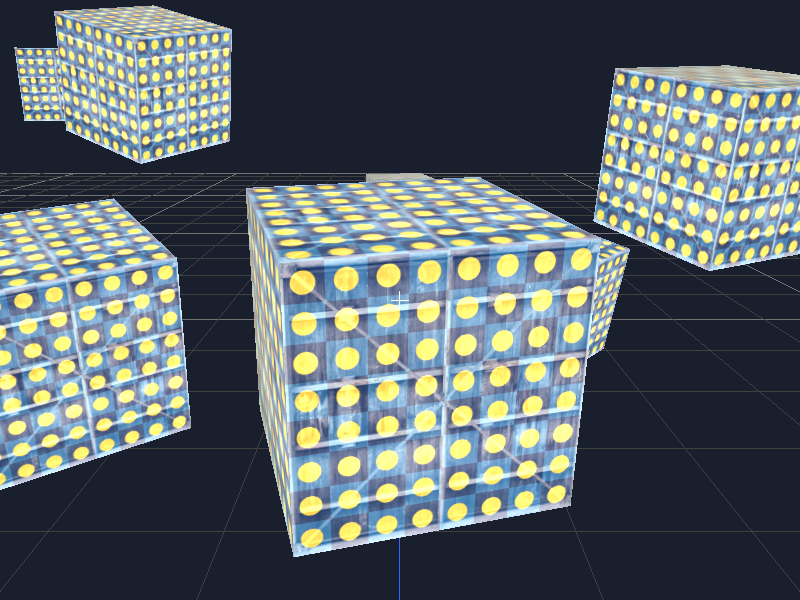 |

* **Көбейту** суретті айтарлықтай қараңғылатты: жәшік пен өрнектің қара
  жерлері қосылып, тек екеуі де ашық жерлер жарық қалды.
* **Қосу** суретті ағартты: ашық жерлер аппақ болып "күйіп" кетті.
  Framebuffer мәнді 1.0-ге өзі қияды, сондықтан 3 және 4-тәсілдің экрандағы
  нәтижесі бірдей. `clamp` нәтижені тек шейдердің ішінде 0…1 аралығына
  келтіреді. Ол кейінгі есептеулер үшін маңызды (мысалы, нәтиже тағы бір
  нәрсеге көбейтілсе немесе HDR буферге жазылса). Ақпарат бәрібір жоғалады:
  1.2 мен 1.8 екеуі де 1.0 болады.

**Қорғауға: көбейту неге тек қараңғылатады?**
Екі сан да 0…1 аралығында болса, көбейтінді **екеуінің ең кішісінен үлкен
болмайды**: `a · b ≤ min(a, b)`, себебі `b ≤ 1` болса `a · b ≤ a`, ал `a ≤ 1`
болса `a · b ≤ b`. Мысалы, `0.8 · 0.5 = 0.4 < 0.5`. Яғни көбейту ешқашан
ағарта алмайды. Ақ (1.0) түсті өзгертпейді, ал қара (0.0) бәрін өшіреді.

* **Кір, дақ, күйе, көлеңке** (ambient occlusion, lightmap) → **көбейту**.
  Олар бетті тек қараңғылатуы керек. Кір картасы ақ болған жерде бет таза
  қалады.
* **Жалын, ұшқын, жарқыл, неон, лазер** → **қосу** (additive). Жарық
  жарыққа қосылады, ешқашан қараңғыламайды. Қара (0) жер "жоқ" деген сөз,
  сондықтан жалын текстурасының фонын мөлдір етудің қажеті жоқ.

## 4-тапсырма: логотипті альфамен жапсыру

Екінші текстура `pattern.png`-ден `logo.png`-ге ауысты (5-пернеде 1-бірлікке
`tex3` байланады). Терминалда `logo.png  512x512  арна: 4` деп шығады, яғни
`fmt` логикасы `GL_RGBA`-ны дұрыс таңдады.

```glsl
vec4 base  = texture(texture1, vTexCoord);
vec4 decal = texture(texture2, vTexCoord);
FragColor = mix(base, decal, decal.a);
```

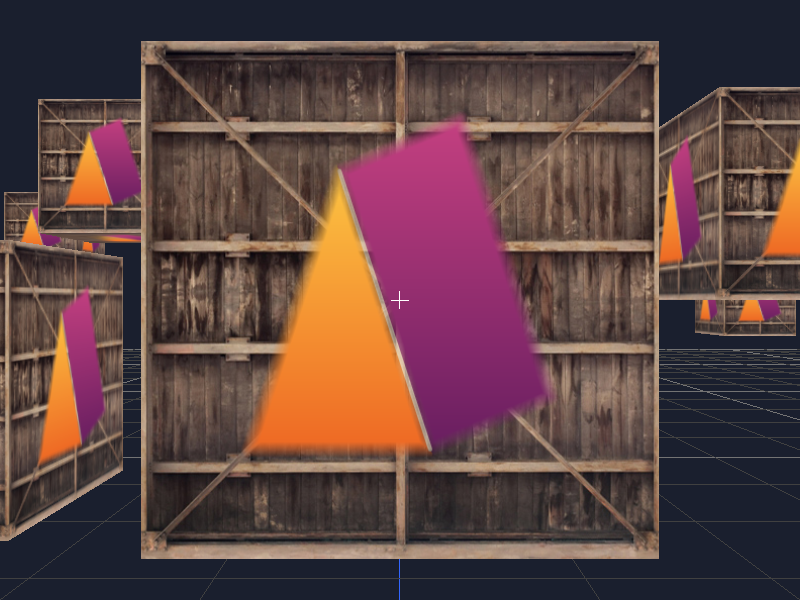

Жәшіктің бетінде призма белгісі тұр, фоны мөлдір, шеттері жұмсақ.

**Қорғауға: үш альфа жағдайы.** Коэффициент енді тұрақты сан емес, ол әр
фрагментте логотиптің өз альфасынан алынады.

| `decal.a` | `mix(base, decal, a)` | Экранда |
|---|---|---|
| **a = 0** | `base` | тек **жәшік**: логотиптің мөлдір фоны |
| **a = 1** | `decal` | тек **логотип**: белгінің толық боялған ішкі бөлігі |
| **0 < a < 1** | `base·(1−a) + decal·a` | **жұмсақ ауысу**: белгінің шеттері (антиалиасинг), жәшік логотип арқылы сәл көрінеді |

Үшінші жағдай логотиптің контурында кездеседі, суреттің альфасында
19 мыңнан астам аралық пиксель бар. Солардың арқасында шеттер "баспалдақ"
емес, тегіс шығады. `blend` мұнда қолданылмайды. Оның орнына `decal.a`
жазылмаса, логотип бүкіл бетті жауып кетер еді.

## 5-тапсырма: кеңістіктік ауысу

Коэффициент UV координатынан алынады, екінші текстура қайтадан `pattern.png`:

| `mix(a, b, vTexCoord.y)` | `mix(a, b, smoothstep(0.3, 0.7, vTexCoord.y))` |
|---|---|
| 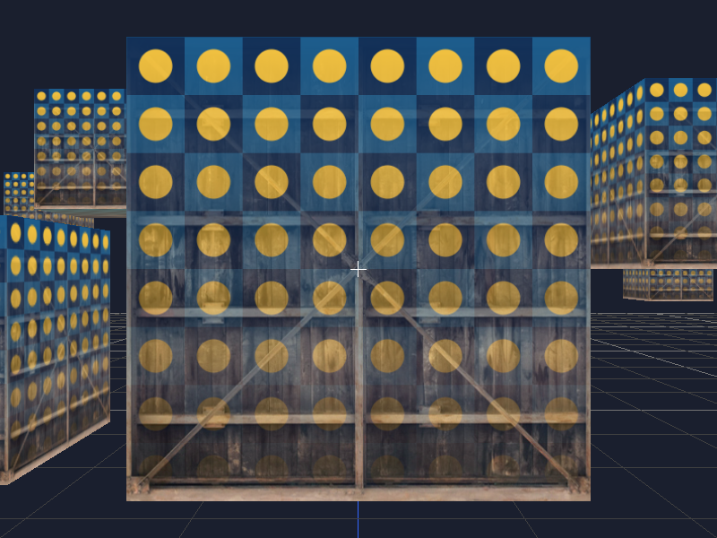 | 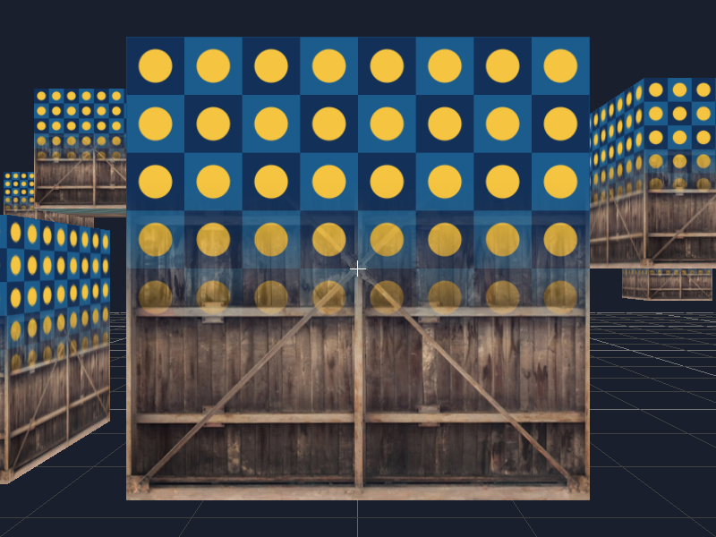 |

Бірінші нұсқада әр жақ төменнен (жәшік) жоғары қарай (өрнек) бірқалыпты
ауысады. `smoothstep` нұсқасында `y < 0.3` жерде таза жәшік, `y > 0.7` жерде
таза өрнек, ал ауысу ортадағы жолаққа сығылып, анық шекараға айналды.

**Қорғауға: нақты ойындарда қайда қолданылады?**

* **Террейн:** биіктікке қарай шөп → тас → қар (`y` орнына әлемдік биіктік),
  еңіске қарай шөп → жартас (коэффициент нормальдың `y` құраушысынан).
* Қабырғаның төменгі бөлігінің ылғалы, кірі, мүгі; жерге жақын жерде шаң.
* Жарылған немесе күйген беттің бір шетінен ауысуы, "еру/жоғалу" (dissolve)
  эффектілері.
* UI: прогресс-бар, денсаулық жолағы, түс градиенттері.

**Ауысуды кездейсоқ ету** (шөптен тасқа біркелкі емес шекара): коэффициентті
**үшінші текстурадан**, яғни **араластыру картасынан** (blend map / splat
map / mask) аламыз. Бұл суретші салған немесе шудан (Perlin/value noise)
жасалған сұр сурет: `t = texture(maskMap, uv).r`. Ақ жерде тас, қара жерде
шөп. Тегіс шекара керек болса, тағы `smoothstep(0.45, 0.55, t)`. Шуды
шейдерде формуламен де есептеуге болады. Бұл 14-аптадағы жылтырлық
картасының (specular map) дәл сол идеясы: әр texel-дің мәні бетінің бір
қасиетін басқарады.

## Қосымша тапсырмалар (барлығы орындалды)

* **Қ1. Үш текстура (8).** `container` + `pattern` (`blend`-пен) + логотип
  (`decal.a`-мен). Үшінші sampler `texture3` 2-бірлікте,
  `glActiveTexture(GL_TEXTURE2)` қосылды. Осы кезде 2-тапсырмадағы ID қатесі
  басқаша көрінеді (жоғарыдағы 05b скриншоты).
  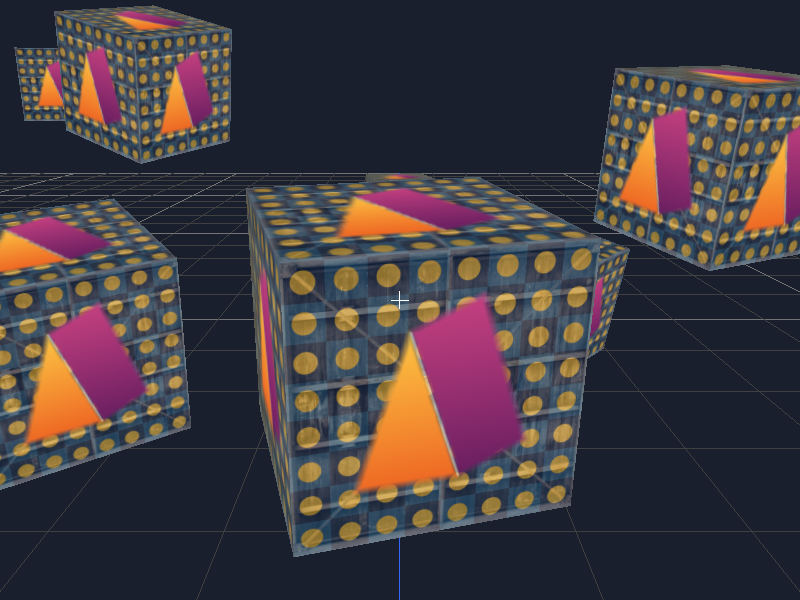
* **Қ2. Автоматты ауысу (B).** `blend = 0.5f + 0.5f * sin(glfwGetTime())`.
  B басылғанда пернемен басқару өшіп, автоматты режимге ауысады, қайта
  басылғанда керісінше. 10-аптадағы "бір рет басу" әдісі қолданылды.
* **Қ3. Әр жаққа бөлек коэффициент (F).** Куб алты `glDrawArrays(GL_TRIANGLES, f * 6, 6)`
  шақыруымен сызылады, `blend = f / 5`: алдыңғы жақ 0 (жәшік), артқы 0.2,
  сол 0.4, оң 0.6, асты 0.8, үсті 1.0 (өрнек).
  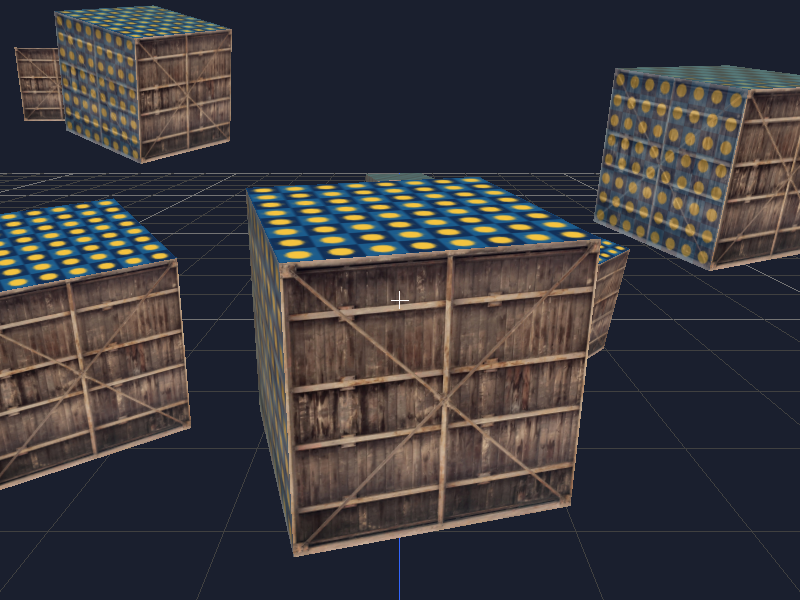
* **Қ4. Логотипті айналдыру (5 + O).** UV фрагмент шейдерінде ортасынан
  бұрылады. `logo.png` `GL_CLAMP_TO_BORDER` пен **мөлдір** шекара түсімен
  `(0, 0, 0, 0)` жүктелген. Сондықтан бұрылғанда 0…1-ден шыққан бұрыштарда
  логотип қайталанбайды, жәшік көрінеді.
  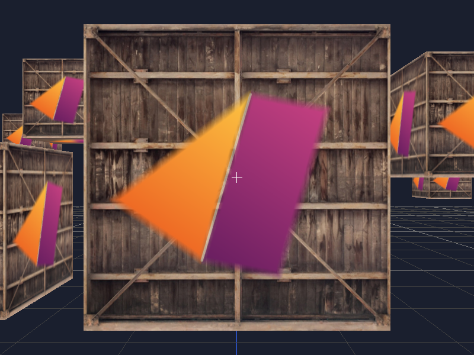

## Тексеру парағы

- [x] Екі текстура да терминалда жүктелгені жазылады
- [x] `glActiveTexture` екі жерде де бар
- [x] `glUniform1i`-ге нөмір берілген (0, 1), ID емес (тек X басылғанда, әдейі)
- [x] `glUniform1i` `glUseProgram`-нан кейін
- [x] `blend` `dt`-ге көбейтілген
- [x] `blend` 0..1 аралығына шектелген
- [x] `logo.png` «арна: 4» деп жүктеледі
- [x] 10 скриншот бар (+ қосымша 6)
- [x] README толтырылған
